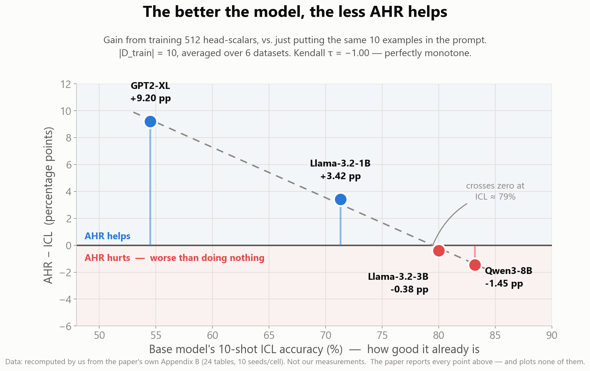
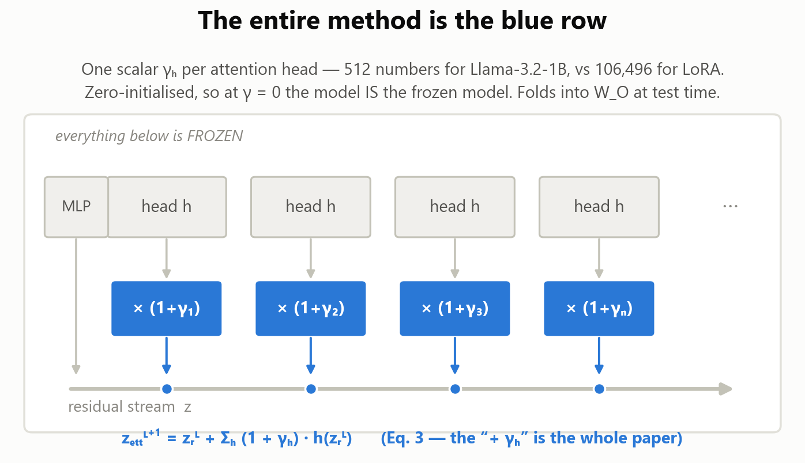
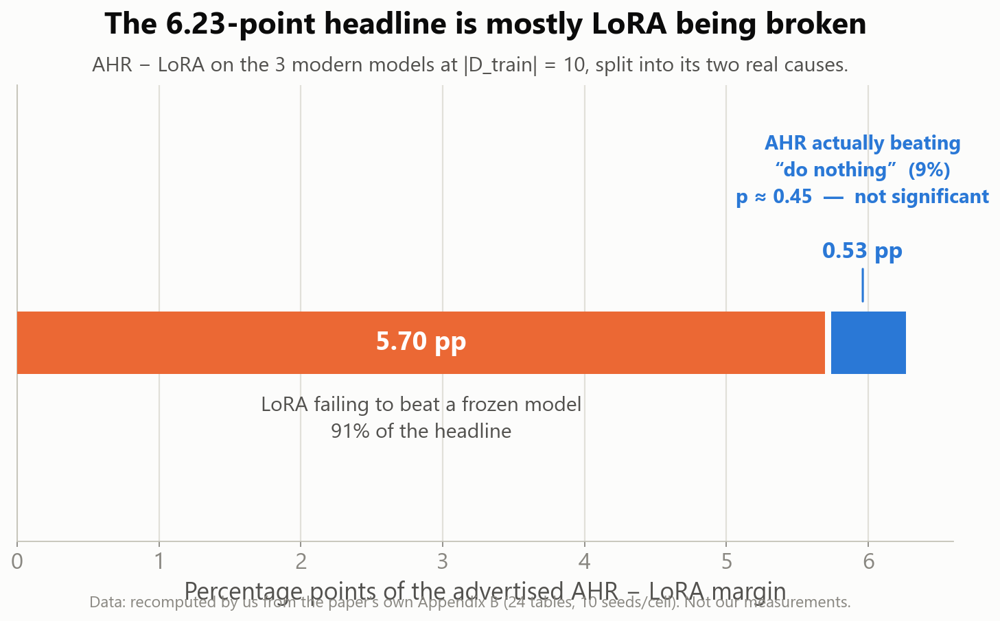
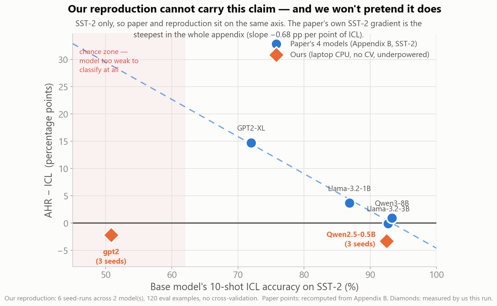

# A 512-number adapter beats LoRA at ten examples. We put back the baseline it left out.

*A reproduction and re-read of "Data-Efficient Adaptation of LLMs via Attention Head Reweighting" (AHR), COLM 2026, arXiv:2607.13425.*

> **TL;DR**
> - AHR adapts a frozen LLM by learning **one scalar per attention head** — 512 numbers for Llama-3.2-1B vs LoRA's 106,496 — and reports beating LoRA by ~6 points at ten labeled examples. The parameter-count claim is true and verified.
> - But the paper's headline compares AHR against LoRA and quietly leaves out the cheapest baseline of all: **in-context learning (ICL)** — the same frozen model with the same ten examples in its prompt. ICL appears in all 24 of the paper's appendix cells and in *none* of its main tables.
> - Put ICL back and it **outranks every trained baseline the paper reports.** AHR's edge over it shrinks as the base model gets better (Kendall τ = −1.00 across four models) and is **already negative for the paper's two strongest models.**
> - We reimplemented AHR from scratch and ran it on a laptop CPU. **AHR never beat doing nothing** at our scale (−2.2 pts on GPT-2-small, −3.3 on Qwen2.5-0.5B). Our pre-registered test of the vanishing-benefit trend *failed*, because the weak model we picked couldn't do the task at all — we report that honestly.
> - The prior art is uncited: **LoFiT** (NeurIPS 2024) already learned a per-head vector and *threw it away*. AHR's real, narrower contribution is keeping a scalar version of it.

---

Here is the surprising claim, stated the way the paper states it: you can specialize a large language model to a new classification task by learning **512 numbers** — one volume knob per attention head — and beat LoRA, which trains 200 times as many parameters, by about six accuracy points when you only have ten labeled examples.

That is a genuinely provocative result, and the mechanism behind it is elegant. It is also, as stated, mostly a story about LoRA being broken rather than AHR being good. Here is what we found when we put the missing baseline back and then actually ran the thing.

*The chart the paper never drew. Every point is recomputed from the paper's own appendix.*

## Why the field was stuck

Specializing a general model on almost no labels has two rival answers, and they've been circling each other for six years.

The first is **in-context learning**: put your ten examples in the prompt and run the frozen model. No training, no new parameters. It works startlingly well — until you notice, as Min et al. showed back in 2022, that ICL mostly *locates* a task the model already knows rather than learning a new one, that it's brittle to phrasing, that it's capped by the context window, and that you pay for those ten demonstrations on every single query forever.

The second answer is **parameter-efficient finetuning**: keep gradients but shrink the parameter count. LoRA won this branch — a small low-rank update, frozen backbone, merges into the weights so inference stays free. Everything after LoRA (AdaLoRA, LoRA+, and friends) tuned *around* LoRA's design rather than questioning it.

But at ten examples, both answers have a problem that's really the *same* problem seen from two sides. LoRA has thousands of free parameters and ten examples to constrain them, so it can — and does — memorize noise. ICL has zero trainable parameters and can't absorb much genuine task signal at all. The field was stuck between too much capacity and none.

## The minimal change

AHR's move is to spend the parameter budget at a unit that *means something*. In a transformer, each attention head writes an additive contribution into a shared "residual stream" — a decomposition made precise by Elhage et al.'s transformer-circuits work. Because the contributions are independent and additive, "how loud is this head?" has a clean one-number answer.

So AHR gives every head one scalar `γ_h`, starts them all at zero, and scales each head's contribution to `(1 + γ_h) · h(z)`. Freeze everything else — every weight inside every head, every MLP. Train the scalars on your ten examples. At test time, fold `γ` into the output projection so inference cost is unchanged.

The key property is what AHR *can't* do. LoRA can write brand-new directions into the residual stream. AHR can only turn existing ones up or down. It cannot invent a feature the pretrained model doesn't already compute; it can only re-mix. That sounds like a weakness. The paper's bet is that at ten examples it's the whole advantage — a method too inexpressive to memorize your training set is safer than one that can.

That bet, it turns out, is correct. It's just not the bet the abstract is selling.

**One thing to flag before going further, because the honest version of this story requires it:** the parameterization isn't new. A NeurIPS 2024 paper called **LoFiT** already learned a rescaling *vector* per head — same `(1 + ·)` form, same frozen backbone, same sparsity penalty, same small-data setting — and then threw the scalars away, using them only to pick which heads to tune. AHR's genuine contribution is narrower than "we invented per-head reweighting": it's "the thing LoFiT discarded works on its own, and works better if you shrink it from a vector to a single scalar." That's a real result. It also means the most natural baseline — does a scalar per head actually beat a vector per head at ten examples? — is one the paper never ran. LoFiT is uncited.

## The baseline that isn't in the table

Now the part that changes everything. The paper's main results table compares AHR against LoRA, AdaLoRA, and (IA)³. It does *not* include ICL — the frozen model with the same ten examples in its prompt, the zero-training baseline that costs nothing to evaluate.

But the paper *did* run ICL. It's right there in Appendix B, in all 24 model-by-dataset cells. It's just not in any main-paper table. So we recomputed it.

At ten examples, averaged across the paper's six datasets and four models, ICL scores **72.26**. LoRA scores 68.27. AdaLoRA 71.22. (IA)³ 67.88. **The frozen model — no training, no adapter, nothing — outranks every trained baseline the paper reports.** The ranking in the paper's table is an artifact of which rows got printed.

AHR still edges ICL on average, by about 2.7 points. But that average hides the actual finding, which is the chart at the top of this post. Break the AHR-minus-ICL gap out by model and sort by how good each model is at in-context learning:

- GPT2-XL (2019, weak ICL): AHR beats ICL by **+9.20**
- Llama-3.2-1B: **+3.42**
- Llama-3.2-3B: **−0.39**
- Qwen3-8B (strongest): **−1.45**

That's perfectly monotone — Kendall τ = −1.00, every pair in order. **AHR's benefit over doing nothing is a decreasing function of how good the base model is, and it's already negative for the two strongest models the authors tested.** And it's not a gentle slope: on the two weaker models AHR beats ICL in 10 of 12 dataset cells; on the two stronger ones, in 2 of 12. A Fisher exact test on that split gives p = 0.0033. The benefit doesn't fade. It falls off a cliff somewhere between 1B and 3B.

So where does that ~6-point margin over LoRA come from? On the three modern models, averaged across all six datasets, AHR beats LoRA by 6.23 points. (The paper's "6–7 points on security tasks" is the same story on Web and Jailbreak specifically — against ICL rather than LoRA, AHR's modern-model edge there is only +1.2 and +0.3.) Decompose the 6.23:

Of those 6.23 points, **5.70 is LoRA failing to beat the frozen model**, and only **0.53 is AHR beating "do nothing"** — and that 0.53 has a paired t of 0.78 across 18 cells, p ≈ 0.45. Statistically indistinguishable from zero. The headline is 91.5% a fact about LoRA being broken at ten examples, which the paper itself notes in passing and then builds its abstract on top of anyway.

## We actually ran it

Recomputing someone's appendix is one thing. We wanted to touch the method, so we reimplemented AHR from the paper's equations — the official repo is a placeholder README with no code — and ran it on a laptop CPU. No GPU, 90-minute budget, so this is a toy-scale reproduction and we'll be blunt about that throughout.

First, a correctness gate we set before anything else: with all scalars at zero, does our implementation reproduce the frozen model exactly? Yes — **bitwise**, max logit deviation 0.000e+00 on both models. (And perturbing one scalar moves the logits by ~8, so the hook is genuinely live, not silently doing nothing.) Good. Everything downstream is admissible.

An aside we didn't expect: the paper's regularizer, written literally, **doesn't run at the paper's own initialization.** The penalty is an Lp *norm*, which isn't differentiable at the origin — and the method zero-initializes every scalar. For the paper's main setting (p=2), the first backward pass computes `0/0` and emits a NaN that poisons everything. We hit it exactly: finite loss at step 0, NaN after. The paper almost certainly means squared L2, which is what we used. But it doesn't say so, and there's no code to check against.

Now the results. Two models (GPT-2-small, Qwen2.5-0.5B), three arms (ICL / AHR / LoRA), three seeds, SST-2, 120 eval examples, fixed hyperparameters, no cross-validation:

| Model | ICL (no training) | AHR | LoRA r=1 |
|---|---|---|---|
| GPT-2-small | **50.83 ± 7.07** | 48.61 ± 3.93 | 48.61 ± 3.93 |
| Qwen2.5-0.5B | **92.50 ± 0.68** | 89.17 ± 2.04 | 66.67 ± 13.81 |

**The frozen model is the best arm on both.** No training run of either method, at either scale, beat leaving the weights alone. On the competent model, AHR came in 3.3 points *below* doing nothing — and that gap is outside our seed noise, so it's a real decline, not a wobble.

### The honest verdict on our own experiment

Our actual pre-registered experiment wasn't "does AHR win." It was the gradient: does AHR's advantage over ICL shrink as the base model gets more competent? We predicted at least 3 points of separation between our weak and strong models. **We got 1.11 points. The prediction failed.**

We're not going to dress that up. The reason it failed is instructive but it's a diagnosis, not an excuse: our "weak" model wasn't weak, it was **broken**. GPT-2-small's in-context accuracy on SST-2 is 50.83 — coin-flip, and actually *below* the 54% you'd get by always guessing the majority class. It collapses to a single class in every seed, and which class it picks tracks the label balance of the ten demonstrations exactly (a known failure called majority-label bias). A model that can't do the task in-context has no ICL machinery for AHR to amplify, so the big "weak-model win" our prediction needed was unreachable by construction. We spanned *broken → good*, not the paper's *weak → good*. The gradient still rests on the paper's four models, not ours, and we say so.

But two things *did* reproduce, one of them sharply. LoRA at ten examples is a disaster: on the competent model it scored 25.8 points below the frozen model, with one seed literally driving its training loss to 0.0001 and emerging as a constant classifier. AHR "beat" LoRA by 22.5 points — which, once you see the ICL arm, is entirely LoRA collapsing rather than AHR winning. That's the paper's own decomposition, reproduced at 0.5B scale in a sharper form than the paper's own numbers. And the mechanism held exactly as advertised: AHR's scalars stayed tiny (|γ| ≈ 0.07–0.11) and never collapsed, because AHR structurally *can't* memorize ten examples. **The paper's core mechanical claim is real and we confirmed it.** What we dispute is only whether that robustness buys anything over not training at all.

The single cleanest correspondence: our Qwen2.5-0.5B sits at ICL 92.50; the paper's Llama-3.2-3B sits at 92.71 — nearly identical base competence. The paper reports AHR − ICL = −0.11 there. We got −3.33. Same sign, independently derived, at a sixth the parameters. Agreement that AHR *doesn't help*.

## What it means

If you're building with this, three takeaways.

**The finding that survives is worth internalizing: at very small label budgets, capacity is a liability.** LoRA at ten examples isn't a weak adapter, it's a net-negative one — worse than the frozen model in 20 of the paper's 24 cells. That is a real, useful, slightly uncomfortable fact about few-shot finetuning, and AHR demonstrates it cleanly by being the method that *can't* overfit. If you've been reaching for LoRA on tiny datasets, the honest default is probably "put the examples in the prompt and stop," measured against your actual baseline.

**Always include the do-nothing baseline.** The entire gap between "AHR beats every baseline" and "the frozen model beats every trained baseline" is one row that was present in the appendix and absent from the table. This isn't unique to one paper; it's the most common way a true-but-narrow PEFT result gets inflated. When you evaluate an adapter, the frozen model with the same context in its prompt is not optional.

**AHR's addressable market is models too weak to do ICL — and that market is shrinking.** The benefit is real precisely where the base model is bad at in-context learning, and it's gone by the time you're at a modern 3B. As base models improve, the case for this specific method weakens by its own evidence.

## What we'd try next

The most interesting thread runs *against* the paper's own framing, and it comes from three of the paper's own results: a couple of heads get boosted on *every* dataset, training on one task improves the others, and a free two-head edit with no data helps everywhere. Put together, those suggest AHR might not be learning tasks at all — it might be an **ICL amplifier**, turning up general in-context-learning machinery that pretrained models systematically under-weight.

If that's true, there's a cheap, falsifiable test: fit one scalar vector on a single dataset (or average across a few), freeze it, and apply it to completely unseen tasks with *zero* task-specific data. If a fixed, task-agnostic vector recovers most of AHR's average gain over ICL — and the paper's own results predict it will — then AHR isn't a data-efficient adaptation method. It's a one-time constant you could ship with the model. Either outcome is publishable: confirmation kills the method's premise, refutation rescues it and supplies the ablation the paper needed.

The other obvious experiments: run **LoFiT** as the baseline the paper skipped (scalar-per-head vs vector-per-head at ten examples is the whole thesis, untested); and plot the gradient properly on a single model family swept across sizes, which both controls for confounds and fixes our broken-weak-model problem. That last one is about an A100-day of compute. It's the experiment this paper should have run, and our failed prediction still points straight at it.

And one test that would tell us whether we've been unfair to AHR: because the trained scalars fold into the weights, you can run AHR with the ten demonstrations *removed* from the test prompt. If accuracy holds, AHR buys something ICL can't — you pay the demonstrations' cost once at training instead of on every query forever — and our "no benefit over doing nothing" verdict is really "no benefit over ICL *as the paper measures it*," not a ceiling on the method. The paper never ran that either; on a CPU, neither could we. It's the strongest open case for AHR, and we're saying so rather than pretending it's closed.

---

*Full reproduction report, code, and the honest per-prediction verdicts are in the run artifacts. Everything above is grounded: the appendix re-analysis is arithmetic on the paper's published tables, the reproduction numbers are from our run, and where our test failed we said so. Scale caveat, stated once more plainly: our reproduction is 124M–0.5B models on a laptop CPU, one dataset, 120 eval examples, three seeds, no cross-validation. It settles the sign of an effect at the small end, nothing more.*
