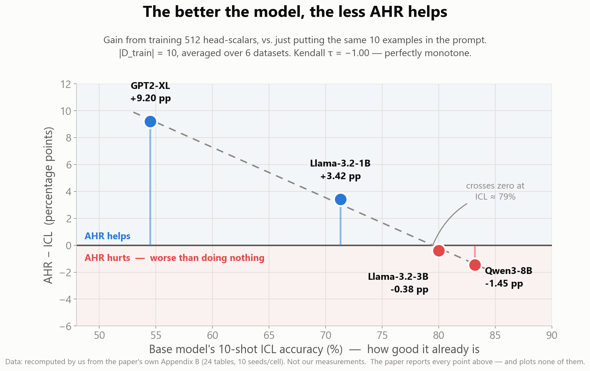
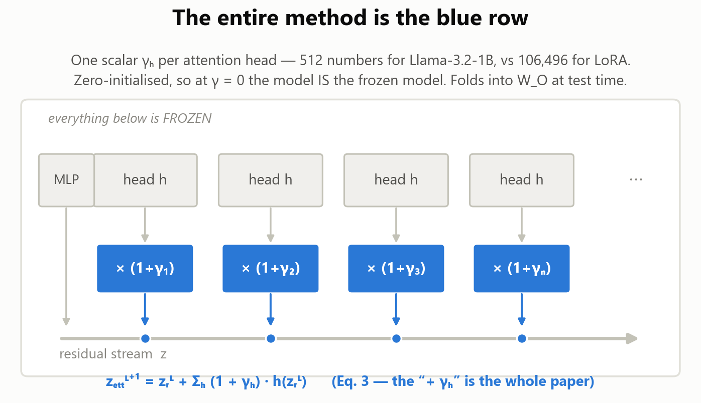
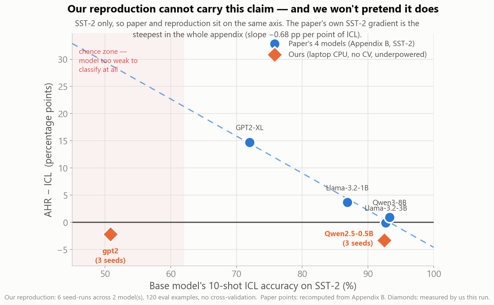
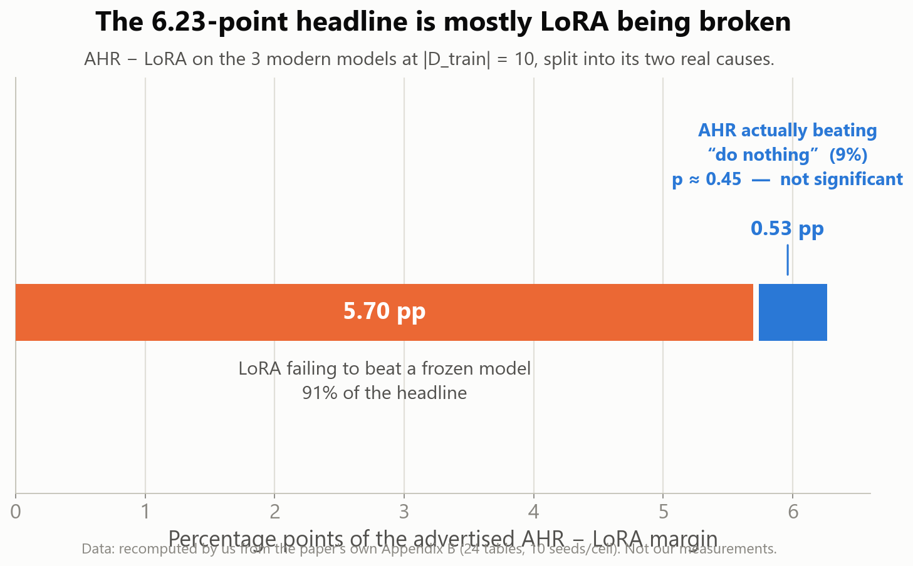
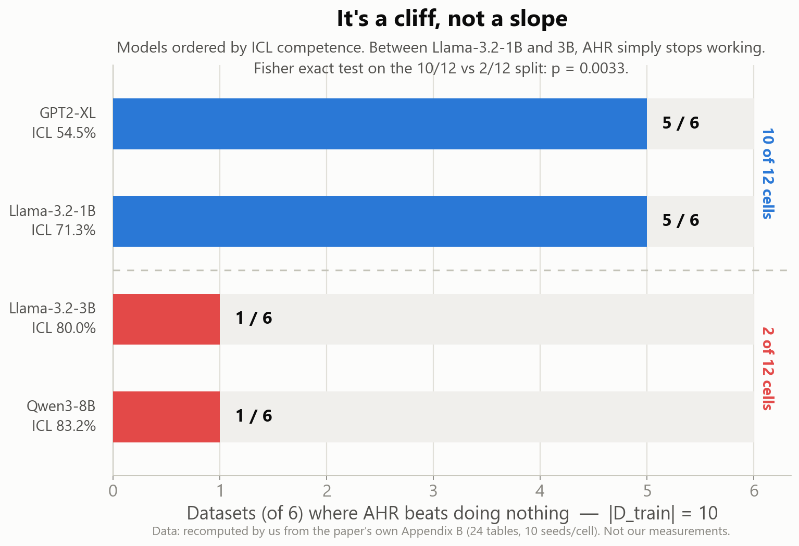

# Putting the Baseline Back: A Reproduction and Deep-Dive of *Attention Head Reweighting*

**A reproduction report in the style of the ML Reproducibility Challenge.**
Target paper: Oikarinen, Chen, Siska, Weng, Singh & Gao, *Data-Efficient Adaptation of LLMs via Attention Head Reweighting* (AHR), COLM 2026, arXiv:2607.13425v1.
Reproduction run: 2026-07-16, on a laptop CPU. All figures and numbers below are recomputed from the paper's Appendix B (`ingest/_appendixB.json`) or measured in our run (`reproduction/results.json`); none are hand-typed.

---

## Abstract

AHR adapts a frozen language model to a text-classification task by learning a single scalar "volume knob" per attention head — 512 numbers for Llama-3.2-1B against LoRA's 106,496 — and reports beating LoRA by roughly 6 points at ten labeled examples. We reproduce the method from scratch (the official repository is a placeholder with no code) and re-audit the paper's own appendix. Two things stand out. First, the headline is built on an omitted comparison: the paper reports the in-context-learning (ICL) baseline — the same frozen model with the same ten examples in its prompt — in all 24 of its appendix cells and in none of its main-paper tables. Put ICL back and it outranks *every* trained baseline the paper reports; AHR's advantage over it is a decreasing function of base-model competence (Kendall τ = −1.00 across the four models tested) and is already negative for the two strongest. Second, we ran it. On a laptop CPU across two small models, three seeds, and SST-2, AHR never beat leaving the model alone: −2.22 ± 3.14 points on GPT-2-small and −3.33 ± 1.36 on Qwen2.5-0.5B. Our pre-registered test of the vanishing-benefit trend *failed* — because the weak model we chose could not do the task in-context at all — and we report that failure rather than trimming it. What did reproduce, sharply, is the paper's own buried admission: LoRA at ten examples is broken (−25.83 vs the frozen model on Qwen2.5-0.5B), and AHR's "win" over it is that collapse, not an AHR gain. AHR's genuine, defensible contribution — that extreme inexpressiveness resists overfitting when data is scarce — survives. Its framing as a data-efficient *adaptation* method does not.



*Figure 1. AHR − ICL (accuracy points, |D_train| = 10, averaged over all six datasets) versus base-model ICL competence, recomputed from the paper's Appendix B. The trend is perfectly monotone (τ = −1.00) and crosses zero between Llama-3.2-1B and Llama-3.2-3B. The paper never plots this; plotting it would require putting ICL in a figure.*

---

## 1. Introduction

The problem AHR targets is real and old: how do you specialize a general model to a new task when you have almost no labels? The paper frames it around security — phishing URLs, jailbreak prompts, toxic text — where the labeled set is permanently small and permanently stale, adversaries move faster than annotation cycles, and you want the model updated this afternoon from the twelve examples someone just triaged. In that regime the adaptation method's own capacity becomes the dominant source of error: at ten examples, any method with thousands of free parameters can drive training loss to zero through routes that have nothing to do with the task.

AHR's answer is elegant. Following the residual-stream decomposition of Elhage et al. (2021), each attention head writes an additive contribution `h(z)` into a shared stream. AHR gives each head one scalar `γ_h`, initialized to zero, and scales that contribution to `(1 + γ_h)·h(z)`. Everything else — every weight inside every head, every MLP — is frozen. The trainable parameter count equals the model's head count: 512 for Llama-3.2-1B, 1,200 for GPT2-XL, about 0.0001% of the weights. At test time `γ` folds into `W_O`, so inference cost is unchanged. The claim: this beats LoRA in the few-shot regime with 200–1000× fewer trainable parameters, and the learned `γ` doubles as an interpretability readout of which heads a task recruits.

This paper matters now for two reasons beyond the method. It is a clean case study in how a strong, true, narrow result gets dressed as a broad one through the choice of which baseline appears in the main tables. And it is a concrete stress test of the "parameters are the thing to minimize" instinct that dominates PEFT: AHR pushes that instinct to its degenerate limit — one number per head — and the interesting question is not whether that wins a table but *what it reveals* about where few-shot adaptation actually lives.

Our contribution is a reproduction and re-analysis, not new theory. We (i) reimplement AHR from the paper's equations and verify it is bit-exact against the frozen model at `γ = 0`; (ii) re-aggregate the paper's own Appendix B to restore the omitted ICL baseline; (iii) run a small pre-registered experiment on two models to test whether AHR's benefit really tracks base-model competence; and (iv) report an honest verdict, including a pre-registered prediction that failed.

## 2. Background and related work

**In-context learning is the baseline that matters.** GPT-3 (Brown et al., 2020) showed a frozen model learns from demonstrations in the forward pass, no gradient updates. Min et al. (2022) then showed ICL largely *locates* a task the model already knows rather than learning a new one — replacing demonstration labels with random ones barely hurts — and Webson & Pavlick (2022) showed it is brittle to phrasing. So ICL is cheap and strong but capped by the context window and taxed on every query by the demonstrations' inference cost. Crucially, it is a baseline that requires *zero training* to evaluate, which is exactly why the paper could afford to run it in every appendix cell.

**PEFT shrank the parameter count.** Prefix-Tuning (Li & Liang, 2021) froze the model and optimized a continuous prefix; LoRA (Hu et al., 2022) won the field with a zero-initialized low-rank update that merges into the weights at test time. The refinements that followed — AdaLoRA (Zhang et al., 2023a) reallocating rank by importance, LoRA+ (Hayou et al., 2024) fixing learning rates — all tuned *around* LoRA's parameterization rather than questioning its granularity. The pivotal ancestor is (IA)³ (Liu et al., 2022), which adapts by *rescaling frozen activations rather than editing weights* — exactly AHR's move — but scales per hidden dimension, a unit with no functional referent. AHR's honest one-line position is "(IA)³ with an interpretability-motivated grouping (heads) and a 10× smaller budget."

**The parameterization is not new — and its closest relative is uncited.** This is a novelty finding that must be stated plainly rather than buried, because our lineage check turned it up as the sharpest gap in the paper's evaluation. **LoFiT** (Yin, Ye & Durrett, *Localized Fine-Tuning on LLM Representations*, NeurIPS 2024) freezes the backbone and, in its Step 1, learns a scaling factor **vector** `A_i^l ∈ ℝ^{d_head}` per head, applied as `(1 + A_i^l) ⊙ z^{(l,i)}`, trained with cross-entropy on a small amount of labeled data under an **L1 penalty** — the same multiplicative reparameterization, the same frozen backbone, the same sparsity story, the same beat-LoRA-on-parameter-count framing. The decisive difference is what LoFiT does next: it *throws the scalars away*, using them only to rank heads before learning bias vectors on the top-K. AHR's genuine delta is **granularity + retention** — one scalar instead of a `d_head` vector (≈1k vs ≈131k parameters on Llama-2-7B), and *keep it as the method*. That is a real contribution — "the thing you discarded works alone, and works better 128× smaller" — but it is much narrower than "we propose learning a scalar per head," and it makes LoFiT the natural baseline the paper never ran. Separately, per-head scalar gates go back to 2019: Voita et al. (2019) and Michel et al. (2019) both learned them, pointed at pruning (their gates live in `[0,1]` and can only remove a head; AHR's `(1 + γ_h)` is unbounded and can amplify one). None of the three is cited. The mechanism is old; the *use of it as a data-efficient adaptation method* is the new part, and it is a smaller step than the abstract implies.

**Why heads.** The interpretability line — induction heads (Olsson et al., 2022), function vectors (Todd et al., 2025) — established that a small number of heads carry in-context task information and are causally manipulable. That is the premise that makes a per-head scalar a *principled* place to spend the parameter budget, and the target authors' own prior work sits in this line. It is also the paper's biggest scientific bet: if head specialization is weaker than that story suggests, the parameterization is arbitrary.

## 3. Method analysis

**The forward pass.** For attention layer `l+1`, AHR replaces the standard multi-head sum

```
z_att = z_r + Σ_h h(z_r)
```

with

```
z_att = z_r + Σ_h (1 + γ_h) · h(z_r)                 (Eq. 3)
```

one scalar per head, everything else frozen. Because `γ = 0` collapses Eq. 3 back to the standard sum, **the model at initialization is exactly the frozen model** — the same zero-init property LoRA has, and one with a consequence the paper never draws out (§5).

**The objective** is cross-entropy on the answer tokens plus an `Lp` penalty on `γ`:

```
min_γ  Σ − log P(y | x; γ, θ)  +  λ (Σ_h |γ_h|^p)^{1/p}      (Eq. 4)
```

Since `γ` is zero-initialized, the penalty is a pull toward *the unmodified pretrained model* — a proximity-to-θ regularizer, not generic shrinkage.

**In-Context Finetuning (IC-FT) carries more weight than the method.** Rather than one example per input, AHR builds a k=10-shot prompt `X_i = {x_1, y_1, …, x_i}` and maximizes the probability of all k answers inside it (Eq. 5), scoring only the first answer token. IC-FT is applied to AHR *and every baseline*, so it is not a confound between methods — but it is worth about 10 accuracy points for all of them (the paper's Fig. 3a), which is the single largest real effect in the paper, and it is not AHR.

**A subtlety that changes the meaning of every number: test-time prompts contain the ten demonstrations.** The paper never states this cleanly. We verified it arithmetically from the appendix — the paper's "baseline (unmodified)" value of 70.68 for Llama-3.2-1B (averaged over four datasets) reconstructs *exactly*, to two decimals, from the ICL row at |D_train| = 10 for the same model and datasets. So the "unmodified model" AHR is compared against already has the 10-shot prompt, and AHR is measured as **ICL + trained head reweighting over the same ten examples**. AHR does not replace ICL; it rides on top of it. The `γ` merge is free, but the demonstrations stay in every query's context — so "no additional inference cost" is true of AHR's *parameters* and false of AHR's *deployment*.

One caveat cuts the other way, and we flag it rather than assume it away: because `γ` merges into `W_O`, a trained AHR model could in principle *drop* the ten demonstrations at test time and run demonstration-free, paying ICL's context tax only once during training instead of on every query forever. That would be a genuine advantage over ICL — and it is untested, by us and by the paper, which measures AHR with the ten demonstrations in every test prompt (the 70.68 identity). It is the strongest unmeasured case for AHR over ICL, and the sharpest missing experiment after LoFiT; our verdict is "AHR does not beat ICL *as the paper deploys it*," not "AHR can never beat ICL."

**The minimal change, pinned down.** AHR's hypothesis class is *closed under the frozen model's existing computation*: every reachable model is a re-mix of functions the network already computes. It cannot invent a feature, only re-weight one. LoRA with rank 1 has ~200× more parameters, but the difference is categorical, not quantitative — LoRA can write *new* directions into the residual stream; AHR can only change the gain on existing ones. The whole bet is that at ten examples, expressiveness is a liability and this specific inexpressiveness is the mechanism. Our reproduction (§4) confirms that mechanism directly.



*Figure 2. The method as a diagram. At γ=0 the model is the frozen model, which is why `steps = 0` in the hyperparameter grid quietly means "fall back to ICL."*

## 4. Reproduction

### 4.1 Setup

The official repository (`github.com/tuomaso/attention-head-reweighting`) contains only a placeholder README — no source, no entry point, no dependency manifest. There is nothing to run, so Tier-1 replication is impossible and we reimplemented AHR from Eq. 3 in ~100 lines (`minimal/ahr.py`): a forward pre-hook that scales the per-head slice of each attention layer's `o_proj` input by `(1 + γ_h)`, with `γ` zero-init and everything else frozen. Because no third-party code is executed, the untrusted-code concern is moot.

**Hardware reality.** No CUDA GPU (Intel i5-1235U, integrated graphics; `torch.cuda.is_available() == False`), 16.9 GB RAM, torch 2.9.1+cpu, transformers 5.3.0, peft 0.19.1. The paper's protocol — 4 models to 8B × 6 datasets × 6 train sizes × 10 seeds × 168-config cross-validation — is on the order of 10⁵ full-backprop training runs. We had 90 minutes on a laptop. So we did not attempt the headline; we targeted the cheapest decisive question instead.

**What we tested, and why not the headline.** Re-running "AHR beats LoRA" would burn the box confirming something the paper's own appendix already establishes and nobody disputes. The disputed, cheaper, higher-value claim is **the gradient**: AHR's advantage over ICL shrinks as base-model ICL competence rises. Evaluating ICL costs zero training, which is the only reason this fits on a CPU. We ran two models spanning the low and high end of what the box allowed — GPT-2-small (124M) and Qwen2.5-0.5B — with three arms each (ICL, AHR, LoRA r=1), three seeds, SST-2, a fixed 120-example eval subsample, fixed hyperparameters (lr 3e-3, 50 steps, λ=0.01, p=2), and **no cross-validation**. IC-FT with k=10 was applied to both trained arms. Predictions were registered in `predictions.json` before any code ran.

**The correctness gate (P5).** Before anything else, we checked that `γ = 0` reproduces the frozen model. It does — **bitwise**, max absolute logit deviation 0.000e+00 on both models (144 γ-params for GPT-2-small, 336 for Qwen2.5-0.5B). An anti-trivial check confirms the hook is live: perturbing a single γ to 0.5 moves the logits by ~8. The gate is not passed by a hook that silently does nothing. Everything below is therefore admissible.

**An unplanned finding: Eq. 4 does not run at the paper's own initialization.** The regularizer `λ(Σ|γ_h|^p)^{1/p}` is the Lp *norm*, which is non-differentiable at the origin — and §3 zero-initializes `γ`. For p=2 (the paper's main setting), `d/dγ √(Σγ²)` is `0/0` at `γ = 0`, so the first backward pass emits a NaN that poisons every parameter. We hit this exactly: finite cross-entropy at step 0, NaN thereafter. The paper almost certainly means squared L2 (`λΣγ²`), which is what we use — but it does not say so, and a reader implementing Eq. 4 verbatim from the stated init gets NaN. This is minor as a correction and notable as a sign: the released artifact cannot resolve it, because there is no artifact.

### 4.2 Results

All accuracies are % on the same 120 SST-2 eval examples; mean ± population std over 3 seeds.

| Model | 10-shot ICL (no training) | AHR (144/336 params) | LoRA r=1 (36.9k/67.6k params) |
|---|---|---|---|
| GPT-2-small | **50.83 ± 7.07** | 48.61 ± 3.93 | 48.61 ± 3.93 |
| Qwen2.5-0.5B | **92.50 ± 0.68** | 89.17 ± 2.04 | 66.67 ± 13.81 |

**The frozen model is the best arm on both models.** No training run of either method, at either scale, beat leaving the weights alone. Paired within seed:

| Model | AHR − ICL | LoRA − ICL | AHR − LoRA |
|---|---|---|---|
| GPT-2-small | **−2.22 ± 3.14** | −2.22 ± 3.14 | 0.00 ± 0.00 |
| Qwen2.5-0.5B | **−3.33 ± 1.36** | −25.83 ± 13.59 | +22.50 ± 13.25 |



*Figure 3. Our reproduction (marked distinctly from the paper's numbers) is underpowered and, at GPT-2-small scale, lands at chance. It is a caveat figure, included for honesty, not support.*

### 4.3 Verdict against the pre-registered predictions

| ID | What it tested | Verdict |
|---|---|---|
| P5 | γ=0 ≡ frozen model | **supported** (bitwise, 0.000e+00) |
| P3 | **the gradient — the actual experiment** | **NOT SUPPORTED** (separation 1.11 < 3.0 threshold, and < 3.42 seed spread) |
| P4 | AHR ≤ +3.0 on a modern model | **supported** (−3.33 ± 1.36; within ±5 of the paper's SST-2 fit) |

**P3 failed, and we do not launder it.** We predicted AHR's advantage over ICL would shrink as competence rises, with ≥3 points of separation between our weak and strong models. Observed separation: 1.11 points, below both the threshold and the seed spread. The verdict is *not supported*, full stop. The *diagnostic* reason matters for what a follow-up should do but does not convert the verdict into a pass: our low-end model was **degenerate, not weak**. GPT-2-small's 10-shot ICL is 50.83 — at coin-flip, and *below* the eval set's 54.17% majority-class baseline. It is one-class-dominant in every seed, and the collapse direction tracks the class balance of the ten demonstrations exactly (6 pos/4 neg → answers Positive; 4 pos/6 neg → answers Negative; 3 of 3 seeds). That is **majority-label bias** (Zhao et al., 2021), not recency bias — the final demonstration is Positive in all three seeds, yet two collapse to Negative. A model with no functioning ICL machinery has nothing for AHR to amplify, so the "large gain at the weak end" P3 needed was unreachable by construction. We spanned **broken → good** (50.83 → 92.50), not the paper's **weak → good** (72.00 → 93.29). This is a diagnosis, not "P3 would have passed with a better model" — that is untested.

**What did reproduce, decisively.** LoRA at ten examples is catastrophic: on Qwen2.5-0.5B it scored 25.83 points *below* the frozen model. AHR beat LoRA by +22.50 — nominally a thumping replication of the paper's headline — but our ICL arm shows the entire margin, and more, is LoRA collapsing rather than AHR winning. This is the paper's own central decomposition, reproduced independently at 0.5B scale in a sharper form than the paper's numbers. One seed rendered the mechanism literally: LoRA seed 2 drove its ten training examples to loss 0.0001 and emerged a constant classifier (97.5% one class, 48.33%). AHR's `γ` meanwhile stayed at |γ| ≈ 0.07–0.11, never collapsed, final CE 0.02–0.19. AHR cannot memorize ten examples because it cannot write new directions into the residual stream — only re-mix existing ones. **The paper's core mechanical claim is visible in our run and we confirm it.** What our data disputes is only whether that robustness buys anything over not training at all.

**The single most meaningful correspondence.** Our Qwen2.5-0.5B sits at ICL 92.50; the paper's Llama-3.2-3B sits at ICL 92.71 — near-identical base competence on the same dataset. The paper reports AHR − ICL = −0.11 there. We measure −3.33 ± 1.36. Same sign, larger magnitude, independently derived, at one-sixth the parameter count. That agreement in sign at matched competence is the most meaningful thing in our run — and it is agreement that AHR *does not help*.

## 5. Discussion — threats to validity

**T1 — The omitted baseline is the whole argument.** ICL appears in all 24 Appendix B cells and in none of the main paper's result tables (Table 2 lists AHR/LoRA/AdaLoRA/IA3 only). Put ICL back at |D|=10 and it averages 72.26, beating LoRA (68.27), AdaLoRA (71.22), and IA3 (67.88): **the frozen model outranks every trained baseline the paper reports.** AHR's remaining margin over it is +2.70 overall, +0.53 on modern models (paired across 18 cells, t = 0.78, p ≈ 0.45), and −0.91 on the two strongest. A reader of Table 2 alone cannot recover any of this.



*Figure 4. Decomposing the 6.23-point modern-model margin over LoRA into "LoRA fails to beat ICL" (5.70) and "AHR beats ICL" (0.53, p ≈ 0.45). The abstract's headline is mainly a fact about LoRA.*

**T2 — Model selection has more capacity than the data can support, and it is not method-neutral.** Per seed, cross-validation searches 168 configurations using five folds of 8 train / 2 val examples — ten validation points, selecting among 168 options, by validation *loss*, not accuracy. The grid contains `steps = 0`, which (since every method is zero-init) means "fall back to the frozen model." So every method has "do nothing" available, and AHR ≈ max(ICL, trained) almost by construction — exactly the +0.53-and-never-much-worse pattern observed. LoRA, meanwhile, lands 5.7 points *below* an option that was in its own search space, meaning CV systematically failed to select `steps = 0` for it. The honest reading: part of AHR's win is that it is robust to a broken model-selection procedure, not that it is a better adaptation method. Our own no-CV run cuts the same way and we flag it against ourselves — our LoRA has no `steps = 0` escape hatch, so our −25.83 is *harsher* than the paper's CV'd LoRA. Both of our arms are equally untuned, which preserves the fair comparison, but our absolute numbers are not the paper's.

**T3 — The generalization result contradicts the framing.** The paper reports that finetuning on phishing URLs with AHR *improves* SST-2/AG-News/Emotion, and sells it as "generalizable edits." But a genuine task-specific adapter has no business improving emotion classification. That AHR does is evidence it is not learning phishing — it is turning up general ICL machinery the frozen model was under-using. Combined with the paper's own finding that a couple of heads get large positive γ on *every* dataset, the task-adaptation story is in trouble.

**T4 — The paper's own ablation prices AHR's benefit low.** The paper reports that manually setting γ=+1 on just two heads, with no training data and no task knowledge, moves Llama-3.2-1B from 70.68 → 71.67 (+0.99) averaged over four datasets. Two comparisons, both on the paper's own numbers: on Llama-3.2-1B itself — where AHR beats ICL by +3.53 on those four datasets — that free two-head edit already recovers ~28% of the full method's gain while touching 2 of 512 heads and reading zero labels; and it *exceeds* AHR's entire +0.53 average margin over ICL on the modern-three models (the average into which AHR's own best results are folded). A free, task-agnostic, zero-data edit in the same ballpark as a trained method's benefit is not interpretability evidence; it is an ablation against the method.

**T5 — Weak baseline, uncited stronger one.** LoRA is run at r=1, α=1 "for training stability" — already crippled-for-safety — and still loses to the frozen model in 20/24 cells. No baseline is tuned toward the obvious fix. And LoFiT, the one experiment that would adjudicate AHR's actual thesis (scalar-per-head vs vector-per-head at ten examples), is uncited and un-run.

**T6 — Contamination and metrics.** SST-2 (2013), AG-News (2015), Emotion (2018) and ToxiGen are near-certainly in the pretraining corpora, consistent with ICL scoring near ceiling (92.71 on SST-2 at |D|=10). The paper's own explanation for AHR's phishing success — "less typical of the models' training distribution, so more to gain" — is a contamination argument in disguise, and it predicts exactly the gradient in Figure 1. For security tasks specifically, accuracy on a *balanced* set is the least realistic metric available: nobody deploys phishing or jailbreak detection at the accuracy-optimal threshold. No ROC, no TPR-at-fixed-FPR appears.

**T7 — Compute is never accounted.** AHR trains 512 parameters but backpropagates through the *entire* network — the backward pass is essentially LoRA's cost. We confirmed it: AHR trained 336 scalars in 130–140 s, LoRA trained 67,584 in 127–145 s, identical. "200–1000× fewer parameters" is a storage and optimizer-state metric, not a training-cost one, and the genuinely cheap baseline (ICL, zero training) is the omitted one.

**What holds.** The parameter-count claim (512 vs 106,496) is true and verified. "Capacity is actively harmful at ten examples" is real and we reproduced it mechanically. AHR is robust where LoRA is not — also real. What does not hold is the framing: a method whose benefit over doing nothing is carried by one of four tested models and reverses sign on the two strongest is not well described by "AHR outperforms baselines when learning from limited samples."



*Figure 5. Cell-level win rate of AHR over ICL, |D|=10, from Appendix B. The cliff (Fisher exact p = 0.0033) makes the τ = −1.00 trend robust to "you fit a line through four points."*

## 6. Future directions

**F1 — Plot the gradient, on a controlled axis (the paper's missing figure).** The four model-level points already exist and are perfectly monotone, but per-cell ICL accuracy confounds model competence with task difficulty. A single-family competence sweep — Qwen2.5-0.5B/1.5B/3B/7B on SST-2 plus one harder dataset, |D|=10, ICL vs AHR only, holding tokenizer and pretraining data constant — separates the two and repairs our degenerate-low-end problem. This is roughly one A100-day and is the experiment the paper should have run; our failed P3 still points directly at it.

**F2 — Run LoFiT.** Scalar-per-head vs vector-per-head at ten examples, same protocol. The entire "coarser is better in low data" thesis is currently asserted at one point on a two-point curve.

**F3 — Fix model selection and re-run.** Replace val-loss CV with accuracy-based selection plus a hard `steps = 0` fallback whenever val accuracy fails to improve. Prediction: LoRA's catastrophic |D|=10 numbers largely disappear and AHR's margin collapses toward zero. If so, the paper measures a model-selection artifact.

**F4 — Our minimal-change extension: the universal ICL vector.** Three of the paper's own findings point the same way — a couple of heads get positive γ on every dataset (§5.3), training on one task improves the others (§5.2), and a free two-head edit helps everywhere (Fig. A.3). Take them seriously: fit **one γ vector on one dataset (or average γ across datasets), freeze it, and apply it to entirely unseen tasks with zero task data.** If a task-agnostic γ recovers most of AHR's average gain over ICL — and the paper's three results predict it will — then AHR is not a data-efficient adaptation method at all; it is an **ICL amplifier** that a single fixed 512-number vector, shipped once with the model, could replace. That reframes the contribution from "few-shot PEFT" to "pretrained models systematically under-weight their own ICL heads, and one universal constant fixes it." It is cheap, it follows from the paper's own data, and either outcome is publishable: confirmation kills the method's premise, refutation rescues it and supplies the ablation the paper needed.

## 7. Conclusion

AHR is a clean idea with a true core and an oversold frame. The core — that at ten examples, a method too inexpressive to memorize the training set can be safer than one that can — is correct, mechanistically visible, and something we reproduced directly. The frame — "a data-efficient adaptation method that beats LoRA" — depends on comparing against the wrong baseline. Restore the frozen model with the same ten examples in its prompt, and AHR's advantage vanishes as models get better and is already negative for the strongest models the authors tested. Our own run adds a point at the sharp end (AHR loses to doing nothing on a competent small model) and reproduces the LoRA-is-broken decomposition, while our attempt to trace the full trend failed honestly because we picked a weak model that turned out to be a broken one. The most interesting future work treats AHR not as an adapter but as evidence that pretrained models under-use their own in-context-learning heads — a hypothesis a single fixed vector could confirm or refute for almost no compute.

---

## References

- Akyürek, E., Schuurmans, D., Andreas, J., Ma, T., & Zhou, D. (2022). *What learning algorithm is in-context learning? Investigations with linear models.* arXiv:2211.15661.
- Brown, T., et al. (2020). *Language Models are Few-Shot Learners.* NeurIPS 2020. arXiv:2005.14165.
- Charakorn, R., Cetin, E., Tang, Y., & Lange, R. T. (2025). *Text-to-LoRA: Instant Transformer Adaption.* ICML 2025. arXiv:2506.06105.
- Elhage, N., et al. (2021). *A Mathematical Framework for Transformer Circuits.* Transformer Circuits Thread.
- Hayou, S., Ghosh, N., & Yu, B. (2024). *LoRA+: Efficient Low Rank Adaptation of Large Models.* ICML 2024. arXiv:2402.12354.
- Hu, E. J., Shen, Y., Wallis, P., Allen-Zhu, Z., Li, Y., Wang, S., Wang, L., & Chen, W. (2022). *LoRA: Low-Rank Adaptation of Large Language Models.* ICLR 2022. arXiv:2106.09685.
- Li, X. L., & Liang, P. (2021). *Prefix-Tuning: Optimizing Continuous Prompts for Generation.* ACL 2021. arXiv:2101.00190.
- Liu, H., Tam, D., Muqeeth, M., Mohta, J., Huang, T., Bansal, M., & Raffel, C. (2022). *Few-Shot Parameter-Efficient Fine-Tuning is Better and Cheaper than In-Context Learning [(IA)³].* NeurIPS 2022. arXiv:2205.05638.
- Michel, P., Levy, O., & Neubig, G. (2019). *Are Sixteen Heads Really Better than One?* NeurIPS 2019. arXiv:1905.10650. **(Uncited by the target paper; prior art on the parameterization.)**
- Min, S., Lyu, X., Holtzman, A., Artetxe, M., Lewis, M., Hajishirzi, H., & Zettlemoyer, L. (2022). *Rethinking the Role of Demonstrations: What Makes In-Context Learning Work?* EMNLP 2022. arXiv:2202.12837.
- Oikarinen, T., Chen, Z., Siska, C., Weng, T.-W., Singh, C., & Gao, J. (2026). *Data-Efficient Adaptation of LLMs via Attention Head Reweighting.* COLM 2026. arXiv:2607.13425.
- Olsson, C., et al. (2022). *In-context Learning and Induction Heads.* Transformer Circuits Thread.
- Ostapenko, O., Su, Z., Ponti, E. M., Charlin, L., Roux, N. L., Caccia, L., & Sordoni, A. (2024). *Towards Modular LLMs by Building and Reusing a Library of LoRAs.* arXiv:2405.11157.
- Todd, E., Li, M., Sharma, A. S., Mueller, A., Wallace, B. C., & Bau, D. (2025). *Function Vectors in Large Language Models.* ICLR 2024. arXiv:2310.15213.
- Voita, E., Talbot, D., Moiseev, F., Sennrich, R., & Titov, I. (2019). *Analyzing Multi-Head Self-Attention: Specialized Heads Do the Heavy Lifting, the Rest Can Be Pruned.* ACL 2019. arXiv:1905.09418. **(Uncited by the target paper; mechanical ancestor.)**
- Von Oswald, J., Niklasson, E., Randazzo, E., Sacramento, J., Mordvintsev, A., Zhmoginov, A., & Vladymyrov, M. (2023). *Transformers learn in-context by gradient descent.* ICML 2023. arXiv:2212.07677.
- Webson, A., & Pavlick, E. (2022). *Do Prompt-Based Models Really Understand the Meaning of Their Prompts?* NAACL 2022. arXiv:2109.01247.
- Yin, F., Ye, X., & Durrett, G. (2024). *LoFiT: Localized Fine-Tuning on LLM Representations.* NeurIPS 2024. arXiv:2406.01563. **(Uncited by the target paper; closest prior work — learns a vector per head and discards it.)**
- Zhang, Q., Chen, M., Bukharin, A., He, P., Cheng, Y., Chen, W., & Zhao, T. (2023a). *AdaLoRA: Adaptive Budget Allocation for Parameter-Efficient Fine-Tuning.* ICLR 2023. arXiv:2303.10512.
- Zhang, Q., Singh, C., Liu, L., Liu, X., Yu, B., Gao, J., & Zhao, T. (2024a). *Tell Your Model Where to Attend: Post-hoc Attention Steering for LLMs (PASTA).* ICLR 2024. arXiv:2311.02262.
- Zhao, Z., Wallace, E., Feng, S., Klein, D., & Singh, S. (2021). *Calibrate Before Use: Improving Few-Shot Performance of Language Models.* ICML 2021. arXiv:2102.09690.

*Reproduction artifacts: `reproduction/REPORT.md`, `reproduction/results.json`, `reproduction/minimal/`. Analysis: `analysis/core.md`, amended by `reproduction/analysis-delta.md`. Lineage and novelty check: `litreview/lineage.md`, `litreview/bibliography.md`. Figures regenerable via `viz/make_charts.py`. Word count ≈ 3,900.*
