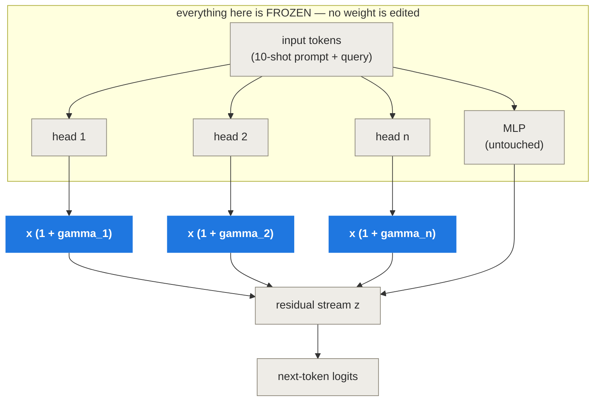

# Method diagram — AHR (Attention Head Reweighting)

**Caption:** AHR adds exactly one scalar per attention head — a volume knob on machinery the frozen
model already computes — and changes nothing else.

Rendered versions of this diagram: `method.svg` (vector, for the paper) and `method.png` (raster,
for social). This mermaid block is the embeddable form for the blog.



**The blue boxes are the entire method.** Everything else is the pretrained network, unmodified.

## Why this is the "minimal change"

| | AHR | LoRA (r=1) |
|---|---|---|
| Trainable parameters | **512** (Llama-3.2-1B) — one per head | 106,496 — ~208x more |
| What it can express | re-mix functions the frozen net **already computes** | **new** directions written into the residual stream |
| At initialisation | gamma = 0 => the model **is** the frozen model | B = 0 => also the frozen model |
| Test-time cost | folds into `W_O`, unchanged | folds into `W`, unchanged |

Equation 3, with the delta highlighted:

```
z_att^(l+1)  =  z_r^l  +  SUM_h  (1 + gamma_h) * h(z_r^l)
                              ^^^^^^^^^^^^^^^
                              the whole paper
```

## The consequence the paper never draws out

Because gamma is zero-initialised, **gamma = 0 is exactly the frozen model** — so `steps = 0`, which
is in the paper's own hyperparameter grid, quietly means *fall back to ICL*. Every method in the
paper is zero-init, so every method has "do nothing" available in its search space. AHR is therefore
close to `max(ICL, trained)` almost by construction, which is what the +0.53 pp-and-never-much-worse
pattern on modern models looks like. See `analysis/core.md` §T2.

**Provenance:** schematic drawn from the paper's Eq. 3 and §3. Parameter counts verified against
Table 1 (= the models' head counts).
